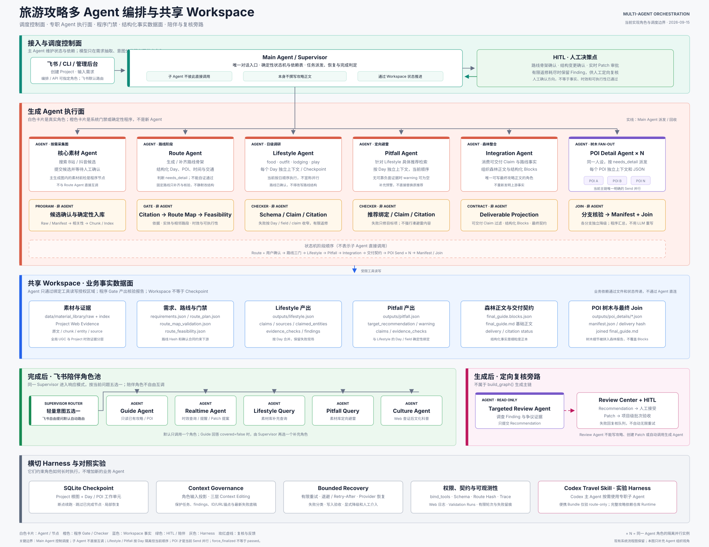

# Travel Multi-Agent

**可核验、可恢复、可局部修补的旅游攻略多 Agent 系统**

面向手工搜集、核验和整理旅游攻略耗时的问题，系统从旅行需求与哔哩哔哩、抖音、小红书等 UGC 素材出发，完成路线确认、Web / 地图核验、逐日攻略和重点景点深挖，生成 Markdown、静态网站与海报，并通过飞书提供旅途问答与提醒。

个人独立开发 · `Python 3.11+` · `LangGraph` · `Pydantic` · `FastAPI` · `React`

> 本项目仅用于个人学习与研究。对外作品快照不附带平台采集数据、账号凭证、用户素材、完整实验现场或 Private Git 历史，也不代表生产就绪。B 站和抖音的自动采集还依赖未随快照分发的可选本地工具，其中抖音适配需自行获取 [MediaCrawler](https://github.com/NanmiCoder/MediaCrawler) 并遵守其许可与平台规则；小红书素材仅支持用户授权的本地导入。

[架构与机制](#架构与机制) · [三层优化](#三层优化与双-harness-反哺) · [实验依据](#实验依据) · [快速开始](#快速开始)


这些示例来自早期青甘 8 日 Project，用于展示真实交付形态，不作为所有质量门禁均通过的证明。

## 架构与机制

LangGraph 承载完整应用主链；Codex 旅游编排 Skill 复用相同业务契约，以独立顶层编排开展对照实验。

| 组成 | 职责 |
| --- | --- |
| `travel-guide-kernel` | 路线快照与 Hash、Schema、Workspace 写权限及交付契约 |
| LangGraph Runtime | 确定性状态路由、用户确认、专职 Agent 与 Checkpoint 恢复 |
| Codex 旅游编排 Skill | 主 Agent 动态派发专职任务，通过 Bridge 复用 Kernel、Validator 与 Workspace |

LangGraph 主链：`Route → 确认 → 路线门禁 → Lifestyle → Pitfall → Integration → POI fan-out → Manifest / Join`。Lifestyle 按 Day 创建隔离的串行工作单元；Pitfall 在其后针对整份多日推荐统一检查；彼此独立的 POI 分支动态并行。

- **工具分工：**FAISS + BM25 + 加权 RRF 检索本地 UGC 体验素材，Web 核验动态信息，高德提供实体与路段证据。
- **路线契约：**以快照和 Hash 固定路线，先检查引用、地图与可执行性；普通事实修复保持路线结构，结构变更须重新确认。
- **长任务恢复：**角色输入投影与三层 Context Editing 控制上下文，SQLite Checkpoint 恢复执行；工具写入校验、有限重试与显式降级约束失败处理。Workspace 保存业务事实。
- **交付隔离：**Claim 绑定来源与核验状态，角色权限和 Schema 约束写入；Integration 只消费可交付 Claim，拒绝引用错位与过期版本。
- **POI 分支：**按 `needs_detail` 并行生成景点内部路线，分支独立核验与恢复，由 Manifest / Join 汇合；返修限定到失败单元。



白色为 Agent / 业务节点，橙色为程序门禁，蓝色为 Workspace。Codex 是独立实验 Harness。

## 真实产物


同一份结构化 Workspace 还能投影为逐日网站和 POI 内部游览页面：[POI 概览](docs/assets/readme/qinggan-qinghai-poi-overview.png) · [POI 路线详情](docs/assets/readme/qinggan-qinghai-poi-route.png)。

## 三层优化与双 Harness 反哺

一次攻略里的问题做局部修补，多个 Project 反复出现的问题沉淀为系统候选，两套 Harness 的实验结论在完成归因后再相互反哺。

| 层次 | 处理机制 |
| --- | --- |
| 项目内修补 | Finding 经人工裁决形成绑定基线 Hash 的 Patch，再执行定向检查与验收。 |
| 跨项目优化 | 按成因聚合重复问题，形成优化候选，回归验证后持续监控。 |
| 跨 Harness 实验 | 按输入、路线基线及可比等级登记 `ComparisonPair`，统一比较工具调用、上下文、恢复与交付；归因后修改对应 Harness 或 Kernel，再以新 Pair 复验。 |

LangGraph 中已验证的业务契约迁入 `travel-guide-codex-orchestrator`；两侧实验发现的改进归因后回到对应 Harness 或共享 Kernel。外层 `long-running-task-supervisor` 根据持久化进度区分正常慢调用、渠道失败与真实停滞，负责观察、等待、故障分类和恢复监督，回放结果单独记录。

详见[优化设计](docs/CONTINUOUS_QUALITY_EVOLUTION_DESIGN.md)与[公开实验证据摘要](docs/public-experiment-evidence.md)。对照实验目录、原始 Trace 与运行现场仅在 Private 开发仓库中留存。

## 实验依据

以下为指定样本结果，统计范围随结果列出。数值来自 Private 仓库的冻结 Project、Trace 和审计记录；对外快照保留口径与限制，不分发原始素材和完整运行现场。

| 机制 | 结果与范围 |
| --- | --- |
| 上下文投影 | 成都样本统稿输入由 **238,953 降至 38,993 字符（−83.7%）**；衡量离线输入体积，不等于端到端 token 或费用降幅。[口径](docs/public-experiment-evidence.md#1-上下文投影) |
| 受监督恢复 | 青甘 V7 从同一 Checkpoint 完成正文、**13 个 POI 与最终 Join**；其中 9 个 `passed`、4 个 `force_finalized`。含两次错误人工中断，属受监督 C 级实验。[口径](docs/public-experiment-evidence.md#2-受监督恢复) |
| Claim 交付隔离 | 青甘 V6 的 **772 条 Claim 中 39 条暂缓**，暂缓 Claim ID 未进入最终正文映射；此项仅检查结构化交付隔离。[口径](docs/public-experiment-evidence.md#3-claim-交付隔离) |
| 定向复核 | 成都同 Route Hash 样本的路线门禁 Web 检索由 **39 次降至 15 次**，范围限定为该样本的门禁检索。[口径](docs/public-experiment-evidence.md#4-路线门禁定向复核) |

## 快速开始

需要 Python 3.11+；管理后台另需 Node.js 20.19+ 或 22.12+。

### 安装与配置

```bash
# 克隆当前作品仓库并进入项目目录后
python3.11 -m venv .venv
source .venv/bin/activate
pip install -r requirements.txt
```

### 零凭证确定性演示

无需模型、Web、高德或私人素材，即可回放一份合成的两日固定输入：

```bash
python scripts/demo/run_deterministic_demo.py --force
```

脚本复用正式的 Workspace 写权限、Schema、Claim 映射、最终交付契约和网站生成器，输出到
`build/public-demo/`。成功时 `demo-report.json` 会记录 `0` 次外部调用、契约问题数和整份交付
摘要；重复回放会得到相同的 `delivery_sha256`。可在另一个终端预览静态网站：

```bash
python -m http.server 8000 --bind 127.0.0.1 \
  --directory build/public-demo/projects/public-deterministic-demo/workspace
```

访问 <http://127.0.0.1:8000/site.html>。演示中的“海岚市”及全部地点均为合成内容；这条入口
验证的是固定产物如何经过结构化契约形成 Markdown 与网站，不会重跑 Agent，也不证明真实旅游
事实质量；路线地图、可执行性和素材事实门禁也不在这次冻结回放中执行。成都、青甘等真实运行
结果仍按上文的样本与限制解释。

### 完整在线模式

完整生成链需要复制环境变量模板：

```bash
cp .env.example .env
```

在 `.env` 中配置 OpenAI 兼容对话模型与 Embedding：

```dotenv
LLM_API_KEY=...
LLM_BASE_URL=https://your-provider.example/v1
LLM_MODEL=...
EMBEDDING_API_KEY=...
EMBEDDING_BASE_URL=https://your-embedding-provider.example/v1
EMBEDDING_MODEL=...
```

地图、搜索、素材采集、生图与飞书凭证按功能配置，见 [`.env.example`](.env.example)。缺少相应凭证时，对应能力会降级或阻断。

### 启动管理后台

```bash
# 终端 1：项目根目录
source .venv/bin/activate
uvicorn src.api.app:app --reload --port 28000
```

```bash
# 终端 2：项目根目录
cd frontend
npm ci
npm run dev
```

访问 <http://127.0.0.1:18888>，后端端口为 `28000`。当前后台适用于本地或可信内网，尚未提供完整公网鉴权。

### 其他入口与验证

<details>
<summary>固定成都 3 日开发样例</summary>

在项目根目录、已激活虚拟环境的终端运行：

```bash
PYTHONIOENCODING=utf-8 python run_mvp.py
```

该脚本使用固定成都 3 日需求，复用同名 Project 的 Checkpoint，可能在路线确认处返回 `action_required`。

</details>

<details>
<summary>Codex 实验 Skill（可安装 Bundle 当前仅完成 route-only 验收）</summary>

在项目根目录、已激活虚拟环境的终端运行：

```bash
python .agents/skills/travel-guide-codex-orchestrator/scripts/install_skill.py \
  --runtime-python "$PWD/.venv/bin/python"

TRAVEL_BRIDGE_PATH="${CODEX_HOME:-$HOME/.codex}/skills/travel-guide-codex-orchestrator/scripts/travel_guide_bridge.py"
python "$TRAVEL_BRIDGE_PATH" doctor
```

可安装 Bundle 的干净环境验收覆盖自主路线草案与确定性结构检查。真实地图、联网证据门禁和完整攻略仍依赖配置好的项目 checkout。详见 [Skill 工作流](.agents/skills/travel-guide-codex-orchestrator/references/workflow.md)。

</details>

<details>
<summary>飞书接入</summary>

使用企业自建应用的 WebSocket 长连接，在 `.env` 配置：

```dotenv
FEISHU_APP_ID=...
FEISHU_APP_SECRET=...
FEISHU_ENABLE_REAL_SEND=true
FEISHU_SITE_BASE_URL=https://your-reachable-host.example
```

在项目根目录、已激活虚拟环境的终端运行：

```bash
PYTHONIOENCODING=utf-8 python run_feishu_worker.py
```

网站地址须指向飞书客户端可访问的 FastAPI 服务。当前公开验证以代码、Mock 与回归为主，完整多轮真实 E2E 仍待补充。

</details>

<details>
<summary>测试与运行约束</summary>

```bash
# Public 快照的确定性后端验收，不依赖私人素材、凭证或可选采集器
PYTHONDONTWRITEBYTECODE=1 python -m pytest \
  tests/test_deterministic_demo.py \
  tests/test_integration_context.py \
  tests/test_experiment_metrics.py \
  tests/test_route_feasibility.py \
  tests/test_codex_skill_bridge.py \
  tests/test_final_guide_blocks.py \
  tests/test_final_guide_validation.py \
  tests/test_workspace_tools.py \
  tests/test_llm_rotation.py -q

# 前端
cd frontend
npm test
npm run build
```

- 完整开发测试还包含依赖 Private 素材库、Provider 配置和未随快照分发采集器的场景，不作为无配置 Public 验收入口。
- 带 `--live` 的评测调用真实服务并产生费用；Mock 与真实 E2E 分别记录。
- Provider 失败后保留原 Project、Trace 与 Checkpoint 恢复。
- 缺少人机交互通道的入口须使用显式路线变更策略。
- `projects/`、`data/`、`runtime/` 与凭证默认不进入 Git。

</details>

## 文档

- [系统架构](docs/ARCHITECTURE.md)与[编排恢复](docs/ORCHESTRATION.md)
- [Workspace 契约](docs/WORKSPACE.md)
- [开发环境](docs/DEV_SETUP.md)
