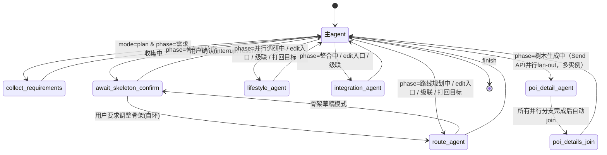

# 编排设计（LangGraph实现层）

> 本文档是 `docs/ARCHITECTURE.md` 第4/5/6节（状态机、依赖图、打回机制）的技术实现落地，说明主agent的调度逻辑具体怎么用LangGraph的StateGraph实现。核心结论：**一张图，主agent为唯一枢纽（Supervisor模式），依赖表驱动路由，不是子agent之间直连。**

---

## 1. 为什么是这个设计（结论先行）

1. **Supervisor模式，不是Handoff/Swarm**：LangChain官方把多agent编排分为两种（[Swarm vs Supervisor架构对比](https://www.augmentcode.com/guides/swarm-vs-supervisor)、[LangChain Blog的Benchmark](https://blog.langchain.com/benchmarking-multi-agent-architectures/)）——Supervisor是中心节点调度、子agent做完把控制权交还中心；Swarm/Handoff是子agent之间用"移交工具"直接互相转交控制权，去中心化。我们最早就定过"子agent之间不直接协作、不直接调用彼此，所有触发和联动都由主agent决策发起"，这就是Supervisor模式，不能用Swarm——业内建议也是"先用Supervisor，简单可控，确认延迟是真瓶颈了再考虑Swarm"（[Supervisor vs Swarm权衡文章](https://dev.to/focused_dot_io/multi-agent-orchestration-in-langgraph-supervisor-vs-swarm-tradeoffs-and-architecture-1b7e)）。
2. **一张图，两种入口，不是两套机制**："初次规划"和"完成后单独@某agent"需要的底层能力是一样的——按依赖表级联、走整合、处理冲突打回——如果分别实现就是重复逻辑。所以只定义一张图，规划模式和编辑模式只是**不同的入口节点+不同的thread_id**，路由逻辑完全共用。
3. **主agent是星型枢纽，不是链式直连**：所有边都是`主agent↔子agent`，不存在`lifestyle_agent→integration_agent`这种跳过主agent的边。子agent的节点函数里根本没有调用其他子agent的能力——"主agent是唯一调度者"这条原则在图结构层面被硬性锁死，不是靠约定。
4. **共享区（磁盘文件）才是agent间的持久通信介质**，LangGraph的state/checkpointer只是单次thread执行内的记账机制（依赖[LangChain官方Interrupts文档](https://docs.langchain.com/oss/python/langgraph/interrupts)：interrupt/resume是"同一个thread内的暂停继续"，不适合跨会话的持久协作）。这条原则本身依然成立——业务数据的真相源始终是`workspace/*.json`，不是checkpointer。2026-08-13起checkpointer额外承担了断点续跑职责（见第9节）：`build_graph()`改用per-project持久化的`SqliteSaver`（不再是`InMemorySaver`），进程崩溃后重新调用`run_plan(project_id, ...)`能跳过已经完整跑完的节点、agent内层耗时对话的重试也能续上已做的工具调用——但这只是"跳过重复执行/续上中断的调用"这个记账层面的优化，checkpointer里存的state仍然不是拿来当业务事实读的，节点函数该读`workspace/`文件的地方还是读`workspace/`文件，没有变化。

---

## 2. 图结构



所有节点都是"主agent↔某节点"，唯一的例外有两处：①骨架确认阶段`await_skeleton_confirm ⇄ route_agent`这个自环（因为骨架草稿需要反复调整，不需要每次都绕回主agent再判断，这两个节点算作规划早期的一个局部子循环）；②"树木生成中"阶段`poi_detail_agent`是**一对多**的fan-out（同一个节点函数被`Send`API派发多次、并行执行，不是"一个agent一条边"），完成后统一进入`poi_details_join`节点再回到主agent，详见第3.3节。

---

## 3. 依赖表（核心）

依赖表不是LangGraph的边，是**主agent路由函数内部查的一张表**，回答两个问题：①这个agent的产出变了，还有谁要跟着重跑；②这个agent的产出最终要不要经过整合。

> 注意：`route_citation_check_node`/`citation_check_node`这两个引用真实性核验节点（第4.1节）**不在这张依赖表里**——它们是`_route_plan_mode`里`PARALLEL_RESEARCH`阶段的内嵌固定步骤（靠`route_citation_checked`/`lifestyle_agent_done`两个state标志顺序触发），不是"某个agent的产出变了要不要级联"这种依赖关系判断，所以不需要在`AGENT_DEPENDENCY_TABLE`里给它们建条目。

```python
# src/orchestrator.py

MAX_RETRY = 2

# 依赖关系表：key是agent名，value描述"它的产出变了之后，级联关系是什么"
AGENT_DEPENDENCY_TABLE = {
    "route_agent": {
        "downstream": ["lifestyle_agent"],   # route_plan变了，lifestyle_agent必须跟着重跑
        "feeds_integration": True,           # 最终都要经过整合agent合并
    },
    "lifestyle_agent": {
        "downstream": ["pitfall_agent"],     # lifestyle的具体推荐变了，避雷agent要针对新推荐重新检索
        "feeds_integration": True,
    },
    "integration_agent": {
        "downstream": [],
        "feeds_integration": False,          # 它自己就是终点，不需要再级联给自己
    },
    # 2026-07-23已实现，见ARCHITECTURE.md第7节
    "pitfall_agent": {
        "downstream": [],                    # 不产出被其他agent依赖的内容，没有下游
        "feeds_integration": True,           # 但它自己要经过整合agent合并（补充预警标注），不是叶子
    },
    "culture_agent": {"downstream": [], "feeds_integration": False},   # 纯问答，不产出需要整合的内容
    "realtime_agent": {"downstream": [], "feeds_integration": False},  # 静态值只覆盖"纯问答"场景，写入场景是动态判断，见第3.2节
    "material_agent": {"downstream": [], "feeds_integration": False},  # 维护全局素材库，不产出任何project的workspace内容
    # poi_detail_agent 不在这张表里：它的调度不是"依赖表级联"，是"树木生成中"阶段专属的
    # Send API并行fan-out + join逻辑，见第3.3节，跟route_citation_check_node不进依赖表是同一个理由
    # （不是"某个agent产出变了要不要级联"这种判断，是内嵌在某个phase里的固定步骤）
}

# 状态机phase → 图节点 的映射，只在"规划模式"下使用，跟依赖表是两张不同的表
PHASE_TO_NODE = {
    "需求收集中": "collect_requirements",
    "骨架确认中": "await_skeleton_confirm",
    "路线规划中": "route_agent",
    "并行调研中": "lifestyle_agent",
    # "整合中" 和 "树木生成中" 和 "完成" 单独处理，见路由函数（"树木生成中"不是一对一映射，
    # 是fan-out到多个poi_detail_agent实例，PHASE_TO_NODE这种简单字典结构表达不了，见第3.3节）
    # 2026-07-23已实现：避雷agent接入后，"并行调研中"phase没有拆成独立phase名——跟
    # route_citation_check_node/citation_check_node同样的模式，`pitfall_agent_node`/
    # `pitfall_citation_check_node`是`_route_plan_mode`里`PARALLEL_RESEARCH`分支内部
    # 硬编码的顺序步骤（靠state标志`pitfall_agent_done`/`pitfall_citation_checked`
    # 顺序触发），不是通过依赖表级联，也不需要新增phase名。
}
```

**依赖表要回答的两件事、分别对应两个字段**：
- `downstream`：级联——这个agent产出变了，哪些agent的产出**已经过时、需要重新生成**。v1只有`route_agent→lifestyle_agent`这一条（衣食住行agent合并后，只剩`route_agent`一个上游依赖，见`docs/ARCHITECTURE.md`第5.1节）；v2接入避雷agent后新增`lifestyle_agent→pitfall_agent`——避雷agent查的是衣食住行agent**具体推荐的内容**（某餐厅/某住宿）有没有踩坑反馈，不是笼统查目的地注意事项，所以必须等lifestyle_agent产出后才能针对性检索，是真实依赖、不是并行叶子（这是本节讨论纠正的一处早期设计问题，`ARCHITECTURE.md`原来把避雷agent写成"仅供参考，不构成强依赖"是不准确的）。
- `feeds_integration`：终点——这个agent的产出是否要经过整合agent合并进最终攻略。`route_agent`/`lifestyle_agent`/`pitfall_agent`都是`True`；`integration_agent`自己是`False`（它是终点）；`culture_agent`/`material_agent`是`False`（纯问答或维护全局资源，不产出需要整合的workspace内容）；`realtime_agent`比较特殊，见下面3.2节，不是固定值。

素材agent和实时agent都不适合直接套用"级联/终点"这套标准依赖表逻辑，各有一种特殊的路由模式，分开说明：

### 3.1 核心素材agent：前置校验，不是级联

核心素材agent维护的是`data/material_library/`，这是**跨project共享的全局资源**——但"共享"不等于"检索不隔离"：`retrieve_materials(topic, query)`永远要求传`topic`，而`topic`就是当前project自己的`requirements.destination`（约定`data/material_library/raw|index/<主题>/`的文件夹名=目的地名称本身，如"成都"，不加后缀，两者恒等映射，不需要模糊匹配），所以"成都"项目的检索物理上碰不到"丽江"文件夹的数据。"不属于任何单个project"指的是**它不是project_id分区的**（多个不同project_id、同一个目的地的项目共用同一份处理好的素材，避免重复抓取/处理），不是说检索没有边界——边界是目的地，只是不是project_id。

它的调用在性质上和其他agent不一样：其他agent的"被主agent调度"是依赖表级联的结果（上游产出变了→下游要重跑），而核心素材agent的"被主agent调度"是**规划开始前的一次前置校验**（这个目的地有没有素材、有没有raw里新加的文件还没处理，没有/没同步就先去补），跟依赖表级联无关：

```python
def _maybe_run_material_check(state):
    """初次规划、进入正式流程之前的一次性前置校验，不是依赖表级联。"""
    topic = state["requirements"]["destination"]   # topic恒等于目的地字符串，见上面的命名约定
    needs_sync = store.material_needs_sync(topic)
    # True=raw里有还没入库的新文件；None=raw目录/manifest.json压根不存在（完全没有素材）
    # 两种情况都要先去跑一趟，只有False（raw和index已同步）才跳过
    if needs_sync is not False:
        return "material_agent"
    return None                      # 素材齐且已同步，走正常的PHASE_TO_NODE流程
```

> **实现时修正的一个坑**：最初这里用的是`material_index_exists(topic)`（只判断index存不存在），实际实现后发现这样只在"全新目的地、一条素材都没处理过"时才会触发前置校验——如果`raw/<主题>/`下已经有过素材、后来又手动加了新的原始文件（比如又下载了一条新视频转写），`index/`里已经有内容了，`material_index_exists`会返回`True`直接跳过检查，新加的那条素材永远不会被自动处理，除非手动再跑一次`ingest_topic()`。改成`material_needs_sync`——对比`raw/<主题>/manifest.json`里登记的文件集合和`index/<主题>/entries.jsonl`里已入库的文件集合，只要有差集就触发`material_agent`节点。`ingest_topic()`本身是幂等的（已入库的文件会跳过，不重复调用LLM），所以这个检查本身开销很低，可以放心作为每次规划前的常规前置步骤。

`material_agent`节点做完之后回到主agent，正常进入下一个phase（不改变`progress.state`的语义，只是这次执行路径上多绕了一跳）。

它也支持**独立@调用**（比如用户主动说"去查一下丽江的最新攻略"），走法和其他agent一样是edit模式的入口（`entry_target=material_agent`）——但要注意：这次调用**写的是全局`data/material_library/index/<目的地>/`，不是当前project的`workspace/`**，所以它在依赖表里`downstream=[]`、`feeds_integration=False`，做完直接`finish`，不会被误认为"这个project的攻略需要重新整合"。即使这次@发生在某个project的对话里，效果也是全局的，跟当前project的进度、依赖表级联都无关。

### 3.1.1 核心素材agent的自主采集：独立的第二个StateGraph，不挂进主图

上面第3.1节讲的是"入库"（`ingest_topic`，处理`raw/`里已有的文件）；核心素材agent还有一层"采集"能力——根据用户需求自主去B站/抖音搜索候选、排序去重、列出候选给人工确认、确认后才真正下载/转写/入库。这条链路实现在`src/agents/material_agent/collection_graph.py`，是**独立于主图（`src/orchestrator.py`的`build_graph`）的第二个`StateGraph`**，不共用`AGENT_DEPENDENCY_TABLE`，不挂进`main_agent_router`——原因和第3.1节"前置校验不是级联"一致：素材agent操作的是跨project共享的全局资源，单独@调用本来就不影响任何project的状态机。

**三节点结构**：`propose`（构建带采集工具的`material_agent`，react-agent内部可能多轮调用`search_bilibili`/`search_douyin`换关键词/翻页凑够候选数量，最后调用`propose_candidates`提交）→ `await_confirm`（默认`auto_confirm=True`时跳过真正暂停，把候选全部自动当作确认放行；`auto_confirm=False`时才走`interrupt()`暂停，把候选列表和摘要交给人工，只做只读+interrupt，不放副作用代码，和`await_skeleton_confirm_node`同款约束——resume时这个节点会重跑）→ `collect`（纯函数节点，不调LLM，B站候选逐条调用`collectors.bilibili.collect_one`，抖音候选批量调用`collectors.douyin.collect_many`一次性抓元数据+合并补ASR避免每条候选各开一次浏览器，最后统一调`ingest_topic`走质量门禁正式入库）。

**auto_confirm默认True**：还没有真实交互界面能把中断payload真正展示给人工点选前，暂停对用户来说等于流程卡住且看不出卡在哪（真实E2E验证时靠管道预先喂决策文本硬跑过去才能测通，见`docs/ISSUES.md`第18条）。默认自动放行全部候选，`select:`/`more:`两种非全量确认路径仍保留在代码里，未来接入真实UI时显式传`auto_confirm=False`即可恢复原有的暂停等待行为，不需要改节点内部逻辑。

**interrupt payload格式**（`auto_confirm=False`时才会真正触发）：
```python
{
    "question": "以下是候选，回复 confirm 全部采集 / select:0,2 只选部分 / more:<补充要求> 重新搜索",
    "candidates": [...],  # propose_candidates工具提交的列表
    "summary": "...",     # 一句话摘要，说明用了什么关键词/排序方式
}
```
resume时传入的决策字符串支持三种前缀：`confirm`（全部采集）、`select:0,2`（只选序号0和2）、`more:<补充要求>`（不满意，清空`proposed_candidates`重新回到`propose`节点，`request`更新为补充要求）。

**触发方式**：`src/agents/material_agent/collection_graph.py`的`run_material_collection(topic, request, thread_id=None, auto_confirm=True)`函数是独立入口，或者通过`python -m scripts.materials.run_material_agent`运行素材采集CLI（加`--manual-confirm`可以手动测试`auto_confirm=False`的暂停/恢复路径），手动跑一次完整的propose→confirm→collect流程做验证。~~这条链路目前不接入`orchestrator.py`的主`main_agent_router`，如果未来要支持"在主对话里直接说'帮我搜几条素材'"，需要在主agent的路由逻辑里加一个分支去调用这个独立图，这次没有做（不在这轮范围内）~~ **2026-07-25已接入飞书陪伴模式**（不是接入主图，是在渠道适配层桥接）：`/grilling`访谈定案——继续保持这条图跟`orchestrator.py`主图解耦（素材库是跨project共享的全局资源，硬塞进`entry_target`机制会破坏该机制"project内部对话"的语义一致性），改为只在`src/channels/feishu/service.py`的`_invoke_companion`（陪伴模式，`mode=="companion"`）内部插入一次独立的LLM意图判断（`intent.classify_wants_material_collection`），命中就直接调用已有的`jobs.trigger_collect_material(topic, request)`（`jobs.trigger`通用后台任务框架+topic级并发锁，管理后台已在用的同一套机制），fire-and-forget不等待跑完；`channel`模式（project还没"完成"）完全不触发这条分支——`channel`模式下用户说的话是"针对系统当下正在问的具体问题的直接回答"（追问需求字段/确认骨架），不是自由表达任意需求的场景，接入意义不大，是讨论时明确定的边界。

**补足循环（2026-07-25新增）**：用户要求补的一个体验缺口——`request`里"给我5条"理应是去重/质量门禁后真正入库5条，不是"尝试了5条候选、能采多少算多少"。`material_propose_node`新增`_extract_target_count(request)`（一次轻量LLM结构化抽取，没有明确数字时默认5），`material_collect_node`跑完一轮采集+入库后判断：跨轮次累计的`total_ingested`没达标、轮次未到`MAX_COLLECTION_ROUNDS=3`上限、且这一轮确实有新增入库（说明还有可搜空间，不是已经搜尽）——三者同时满足才清空候选状态、更新`request`说明还差多少条，路由回`propose`重新搜索；否则收工，`result_summary`如实报告实际入库数vs目标数。`search_and_rank`已有的"排除raw manifest里已存在source_url"逻辑天然避免补搜时重复提议同一批已失败候选，不需要额外处理。

**真实E2E过程中按诊断纪律真实查出并修复两个更早就存在、这次才第一次被完整propose→collect流程撞见的独立bug**（详见`docs/ISSUES.md`第55条）：①`material_propose_node`调用agent时只传了`request`原文，从没显式把`topic`告诉模型——真实陪伴对话场景下用户经常不会重复说城市名（比如"帮我搜3条最新的探店视频"），模型只能凭泛词自己乱猜关键词，搜到完全不相关城市的候选被`is_relevant`门禁正确拒绝，表现成"入库0条"看起来像"该目的地没有更多内容"；②`propose_candidates`工具的docstring规格只要求`platform`/`source_url`/`title`/`author`/`score`五个字段，没提`pubdate`，模型严格按规格重新组装候选时如实丢弃了没被要求的字段，下游`collect_one`硬编码索引`candidate["pubdate"]`直接`KeyError`崩溃。两处均已修复。

### 3.2 实时agent：写入是审批后才动态级联，不是固定值

实时agent分两种情况，`feeds_integration`不是一个固定值，是运行时判断：

- **纯问答**（"现在xx天气怎么样"）：不写任何workspace文件，跑完直接`finish`，跟`culture_agent`一样。
- **发起修改**（"这家店已经关门了，帮我更新一下"）：agent先产出一个"待审批patch"，不直接写——进入`await_realtime_approval`（interrupt节点，等主agent/用户批准），批准后才真正调用`write`类工具把patch应用到对应的workspace文件（比如`outputs/lifestyle.json`里的某个字段，走changelog留痕，`actor`标注为`realtime_agent`）。**只有这次运行真的写入了patch，才需要级联`integration_agent`重新合并**；如果被拒绝，patch作废，直接`finish`，不级联。

```python
def _route_after_realtime_agent(state):
    if state.get("realtime_patch_applied"):
        return _route_integration_phase(state["project_id"])   # 真写入了，走整合流程（含冲突处理）
    return "finish"   # 纯问答，或patch被拒绝，都不需要级联
```


---

### 3.3 POI详情agent：整合完成后自动fan-out的并行阶段（2026-07-20设计讨论，**2026-07-21已实现**）

跟第3.1节"前置校验不是级联"、第3.2节"实时agent动态判断"一样，POI详情agent的调度也不是标准的"一对一依赖表级联"，是"树木生成中"这个phase专属的路由逻辑，单独说明。设计背景见`docs/ARCHITECTURE.md`第3.4节。

- **触发条件**：`_route_plan_mode`里，`progress.state == "整合中"`且`integration_agent`产出`final_guide.md`完成、`conflicts.jsonl`无pending冲突时，不像原来直接判定为`"完成"`，而是先进入"树木生成中"。读取`route_plan.json`所有`days[].pois[]`里`needs_detail=true`的POI列表——**列表为空则直接跳过本阶段，进入"完成"**，不强行fan-out零个任务。
- **Fan-out（并行派发）**：列表非空时，路由函数返回一组`Send("poi_detail_agent", {poi, day, ...})`（LangGraph的`Send` API），为每个`needs_detail=true`的POI各自派发一次`poi_detail_agent`节点调用。LangGraph会自动并行执行这些被`Send`派发的调用，不需要手写线程池/`asyncio.gather`，这是本项目**第一次引入跨agent级别的真并行**（此前"并行"只存在于`lifestyle_agent`内部的工具调用层面，见`docs/ARCHITECTURE.md`第3.3节）。
- **各分支内部（互不干扰）**：每个`poi_detail_agent`实例独立完成"检索素材 → 生成`routes`（含`recommended`判断，读取该project已持久化的`requirements.json`） → citation_check核验（复用`_verify_items`，内嵌循环模式，跟`route_citation_check_node`/`citation_check_node`同款实现，见第4.1节） → 写入自己的`outputs/poi_details/day{N}_{poi_slug}.json`"。一个分支的核验打回**不影响**其他分支——打回耗尽走`mark_force_finalize`时，只标记该分支自己产出文件的`citation_status = "force_finalized"`，**不设置project级别的全局`force_finalize`粘性标志**（现有`mark_force_finalize`是project粒度的，这里需要一个新的、按POI区分粒度的实现，不能直接复用，否则一个POI核验没通过会误伤"完成"这个整体判断，见下方"实现时要注意"）。
- **Provider重试耗尽后的一次性恢复（2026-09-04）**：仅限POI首次生成。当`_invoke_with_write_verification`已耗尽GPT-Load完整技术重试、目标文件仍不存在，且异常分类为`provider_or_tool_failure`时，编排层最多发起一次无状态恢复。配置`OOIOO_*`时，该恢复实例使用此前隔离实验成功的`ooioo/deepseek-v4-flash`；未配置时保持旧GPT-Load恢复行为，不影响既有部署。恢复请求只带当天路线、用户需求投影、同`log_scope`候选Project Evidence和明确标成未验证的working notes；工具物理收窄为`retrieve_materials + write_agent_output`，不再联网、追加证据或调用高德。写入成功后继续原Citation Loop；仍失败时保留`generation_failed`。`write_contract_failure`、本地预算/递归停止、已有POI文件或其他Agent都不触发；该渠道不进入其他Agent或结构化核验链。
- **Join（汇合）**：`Send`模式下，LangGraph会在所有被派发的分支都完成后自动进入下一个公共节点——`poi_details_join_node`。这个节点是**纯函数，不调用LLM**：
  1. 遍历所有分支产出的文件，写`outputs/poi_details/manifest.json`（第2.3.1节schema，由join节点统一写，不是各并行分支各自写，避免并发写同一文件的竞态）。
  2. 对每个已生成的POI详情，抽取`recommended=true`路线的途经点摘要，纯程序拼接（类似`build_reference_section`的思路）追加进`final_guide.md`对应POI处+跳转链接——不重新调用LLM，不给已核验通过的森林正文重新引入幻觉风险，也不需要重新走一遍`citation_check`。
  3. 设置`progress.state = "完成"`。
- **实现时要注意（预判的坑，还没真正踩过，先记录）**：
  1. `mark_force_finalize`现有实现是project粒度的单一布尔标志，"树木生成中"阶段需要**按POI区分**（比如`store.mark_poi_force_finalize(project_id, poi_name)`只影响该POI详情文件自己的`citation_status`），不能直接复用现有函数，否则会把"这一个景点没核验过"误判成"整个project需要强制终结"，波及森林正文和其他已经核验通过的POI。
  2. `Send`fan-out对应的`GraphState`字段需要用`Annotated[list[dict], operator.add]`声明reducer（见第5节），不能用普通dict覆盖语义的字段，否则多个并行分支的返回值会互相覆盖而不是累加成列表——这是LangGraph官方文档里`Send`/map-reduce模式的标准写法，不是本项目特有的设计。

- **素材不足时的定向补充检索（2026-07-24新增，2026-08-02大幅收窄——见下方"已移除"说明）**：真实使用中发现，某些POI（如武侯祠内部的"刘备殿/诸葛亮殿"这类子景点）核验反复打回耗尽走`force_finalize`，根因不是模型不行，是素材库对这类"景区内部逐点讲解"内容天然覆盖薄弱（UGC博主更爱写"值不值得去"而不是"进门先看什么"）。现在这条路径只做`_attempt_auto_material_supplement`（判定真缺+项目级预算内自动下载/转写/入库，见`docs/ARCHITECTURE.md`第16节），不再有"只呈现候选、供人工审核"的兜底提示。
  - **已移除（docs/ISSUES.md第98条）**：此前预算耗尽/判定不缺/采集失败时，会回退到`_suggest_collection_candidates`——只读B站搜索候选，写进POI详情文件的`collection_suggestions`字段并反向同步进`final_guide.md`，供"人工审核决定要不要采集"。但这条候选完全没有做`_filter_relevant_candidates`那道相关性过滤（真正的自动采集路径`_attempt_auto_material_supplement`有接这道过滤，这条没接），且从未真正有人工审核入口消费这个字段（前端/后台都没有展示或操作入口），唯一的出口就是直接写进`final_guide.md`——真实评测（青甘大环线场景）里撞见一条明显不相关的成人内容视频标题被原样写入，触发了下游judge评测的provider内容审核拦截。已整体移除这条呈现路径、对应schema字段和final_guide渲染代码。
  - **只覆盖POI详情agent这一条路径**：`route_agent`/`lifestyle_agent`的`force_finalize`路径没有接入`_attempt_auto_material_supplement`之外的呈现机制（跟`docs/ISSUES.md`第4/20条一贯的教训一致——每加一个环节都要单独验证，不能假设"这里加了别处就自动一致"）。
  - **新增：每一轮打回原因持久化（docs/ISSUES.md第98条）**：`_run_poi_detail_citation_loop`每一轮核验打回的具体理由，此前只用于生成给模型看的重试prompt、用完即焚，事后无法查证"这个POI每一轮到底因为什么被打回"，只能靠重新跑一遍核验反推。现在通过`retry_history`字段一起持久化进POI详情文件，补上这个可观测性缺口。
  - **途经点级返修闭环（2026-09-02，`docs/ISSUES.md`第163条）**：核验问题先按`(route_name, order)`分组；同一路线有多个失败点时，也拆成多个确定性工作单元。每个短返修会话只接收目标途经点的完整结构，不继承同路线其它途经点；仍使用原`write_agent_output_patch`，但Store按`route_name + order`分层合并。Patch完成后的核验通过`segment_keys`只复核本轮实际修改的途经点，证据台账也只替换这些`target_key`。这不是把POI路线切成新的业务实体：路线级定位、推荐切换和多点编辑仍由同一工具支持，新增/删除/整体重排仍使用整份覆盖。


- **edit入口（2026-07-26接入，见`docs/ARCHITECTURE.md`第3.4节第9点）**：`poi_detail_edit_node`（`entry_target="poi_detail_edit_node"`，需额外通过`run_edit()`的`day`/`poi_name`参数定位具体是哪一个POI——不像`lifestyle_agent_node`/`pitfall_agent_node`只有一个实例，POI详情agent同一个project里有多个并行实例，单靠`entry_target`无法定位）。跟`route_draft`/`lifestyle_agent_node`/`pitfall_agent_node`同款"定点编辑"模式，但**是一跳结束**——核验内嵌在节点自身（复用`_run_poi_detail_citation_loop`，跟`poi_detail_agent_node`共用），不像lifestyle/pitfall那样需要级联独立的`citation_check_node`/`pitfall_citation_check_node`，也不级联`integration_agent_node`（POI详情本来就不在`AGENT_DEPENDENCY_TABLE`级联链路里）。`_route_edit_mode`新增`last_agent=="poi_detail_agent"`直接`END`分支，跟`culture_agent`同款。
  - **支持四种场景**：①修改已有路线的具体内容；②切换推荐路线（多骨架备选）；③新增一条此前不存在的路线；④首次生成（该POI当初没有被标记`needs_detail=true`，用户事后单独要求补充）。前三种由模型从`edit_request`自然语言判断，不做硬编码字符串匹配。
  - **误改检测排除推荐标记字段**：`_diff_poi_routes(before, after)`返回`(needs_recheck, touched)`——比较路线内容时刻意排除`recommended`/`recommend_reason`两个字段，因为"切换推荐"天然会同时翻转两条路线的这两个字段，如果不排除会被误判成"改动了2条路线"（既触发不必要的越权冲突留痕，又触发不必要的重新核验）。`touched`（`needs_recheck` + 被删除的路线名）超过1条视为可疑越权改动，`report_conflict`留痕（没有下游整合环节会自动复核这条冲突，留作人工在`conflicts.jsonl`里事后审查）。
  - **核验scoping+纯推荐切换零核验成本**：`verify_poi_detail_citations`新增`route_names`参数（跟`fields`/`item_keys`/`days`同一个思路），把核验范围收窄到`needs_recheck`（真正改动/新增的路线）；`needs_recheck`为空（纯粹切换推荐、没有任何路线内容变化）时**完全跳过citation_check**，直接沿用原有`citation_status`——不涉及新的事实性陈述，不需要核验，也避免非确定性判断误伤已通过核验的其它路线。
  - **Patch层级**：普通用户编辑仍可以按路线修改多个途经点；引用核验的自动返修则进一步收窄到单个`(route_name, order)`。两者复用同一个`write_agent_output_patch`，由Store确定性合并未提交的路线与途经点，不新增第二套工具或删除语义。
  - **反向同步不会冲掉其它POI**：`poi_detail_edit_node`完成后从`manifest.json`读取"全部已生成POI"的完整列表（不只是这次被编辑的这一个），更新这一条的`citation_status`后整体重建`final_guide.md`的"🌳"章节（复用`_sync_poi_details_into_final_guide`），不会因为只编辑了一个POI就把其它POI的内容从正文里冲掉。
  - **数据完整性兜底**：`store.write_poi_detail`新增`_clamp_single_recommended_route`——多条`recommended=true`时确定性地只保留第一条，不依赖prompt自觉遵守"同一时刻只应该有一条recommended"这条规则。
  - **验证方式**：mock单元测试（`tests/test_orchestrator_poi_detail_edit.py`13个 + `tests/test_store.py`2个 + `tests/test_materials.py`1个 + `tests/test_orchestrator_graph_level.py`1个，覆盖四种编辑场景/越权检测/核验scoping/反向同步/路由/`run_edit`参数校验），未跑真实E2E。详见`docs/ISSUES.md`第59条。

---

### 3.4 陪伴阶段路由：随身向导agent与意图分流（2026-07-20设计讨论，**2026-07-21已实现**，**2026-07-25接入避雷复查**）

设计背景见`docs/ARCHITECTURE.md`第3.5节。跟第3.3节的`Send`并行fan-out不是同一种模式——陪伴阶段是`edit模式`风格的自由对话入口，路由逻辑的新增部分只在于"用户没有显式@任何角色时，主agent怎么决定路由给谁"。

- **显式@**：跟现有edit模式完全一致，`entry_target`直接指向`向导agent`/`实时agent`/`衣食住行agent`/`避雷agent`对应的节点。
- **未显式@（自由提问）**：一次轻量的意图分类步骤（一次LLM调用，复用主agent本来就有的"理解用户在说什么"这类能力，不是新工具/新模型），`_classify_companion_intent`五选一（`guide_agent`/`realtime_agent`/`lifestyle_agent`/`pitfall_agent`/`culture_agent`，最后一个是2026-08-21新增接入，见下文`companion_culture_query_node`）：
  ```python
  def _classify_companion_intent(user_message: str, candidates: list[str]) -> str:
      """返回candidates之一。"""
      # 依据：问的是"已生成内容"（森林/树木数据能直接回答）→ guide_agent
      #      问的是"需要联网的时效性信息"（现在/最新/还开着吗）→ realtime_agent
      #      问的是"树木没覆盖但素材库可能有更细节推荐"（非时效性的具体推荐类）→ lifestyle_agent
      #      问的是"要不要避坑/有没有踩雷/差评/不推荐的理由"（如"这家店有没有坑"）→ pitfall_agent
      #      问的是"目的地历史文化/民俗风俗/名称由来"这类科普性问题（2026-08-21新增）→ culture_agent
  ```
  分类结果通过`_COMPANION_ENTRY_NODE_MAP`映射到graph节点名：`guide_agent`→`guide_agent_node`、`realtime_agent`→`realtime_agent_node`、`lifestyle_agent`→`companion_lifestyle_query_node`、`pitfall_agent`→`companion_pitfall_query_node`、`culture_agent`→`companion_culture_query_node`。
- **`companion_pitfall_query_node`（2026-07-25实现）**：跟`companion_lifestyle_query_node`同一个思路——不复用重量级的`pitfall_agent_node`（会写入`outputs/pitfall.json`并级联核验/整合agent重新合并），现场构建一个只有检索能力、没有写权限的轻量agent，只回答不落盘。跟`companion_lifestyle_query_node`的两处具体差异：①工具不绑`amap_tools`（真实`pitfall_agent`本身也不绑，避雷是内容检索不是地理位置校验）；②额外读取已有的`outputs/pitfall.json`塞进prompt上下文，避免临时查询的结论跟正式避雷产出互相矛盾/重复。
- **`companion_culture_query_node`（2026-08-21新增）**：跟`companion_lifestyle_query_node`/`companion_pitfall_query_node`同一个思路——不复用重量级的`culture_agent_node`（会累加式写入`outputs/culture.json`，走edit入口正式产出区语义），现场构建一个只有`web_search`+只读`workspace`、没有写权限的轻量agent，只回答不落盘。跟真实`culture_agent`的工具边界一致（不绑`retrieve_materials`/`amap_query`——文化科普不是UGC攻略检索也不是地理校验）。跟`companion_pitfall_query_node`的对应差异：**不读`outputs/culture.json`塞上下文**——pitfall节点读`outputs/pitfall.json`是为了避免临时查询结论和正式避雷产出矛盾，文化科普是纯知识问答，没有"正式产出区已有结论"要对齐的必要（陪伴阶段这次问答也不落盘，自然不存在矛盾这层顾虑）。正式落盘的文化问答仍走原`culture_agent_node`（edit入口显式`@culture_agent`触发，`_route_edit_mode`的`last_agent=="culture_agent"`分支处理），本节点只是只读陪伴版本，`_route_edit_mode`新增`last_agent=="companion_culture_query"`直接`END`分支，跟`companion_query`/`companion_pitfall_query`同款。
- **自动串联（纯查询，不含写入）**：`guide_agent`节点跑完后，如果其产出标记"数据未覆盖"（比如返回结构里`covered: false`），主agent**自动**追加路由到`realtime_agent`/`lifestyle_agent`/`pitfall_agent`/`culture_agent`四者之一（按上面同一套意图分类逻辑，候选收窄为这四个查询型角色，判断该追加查哪个，2026-08-21从三选一扩为四选一同步加入`culture_agent`），把两段结果合并成一次回复返回给用户，中间不需要用户二次确认。
- **写入审批边界不变**：上面这一步自动串联的前提是`realtime_agent`/`lifestyle_agent`/`pitfall_agent`这一跳最终只是"查询"。如果`realtime_agent`在查询过程中判断"这个信息应该更新进公共区"，必须走现有的`await_realtime_approval`（第3.2节），**不能因为这一跳是自动串联触发的就跳过审批**——审批节点的触发条件只看"是否要写入"，不看"这次调用是用户手动发起的还是主agent自动串联发起的"。
- **显式@避雷agent仍走原路径**：用户直接`@`避雷agent（`entry_target="pitfall_agent_node"`）复用第7节场景12（"完成后单独@避雷agent"）已经实现验证过的edit模式全量写入路径，跟这次新增的`companion_pitfall_query_node`自动分类路由是两回事——两条路径的入口判断完全独立（`entry_target`非空时`_route_edit_mode`第一跳直接透传，压根不会触发意图分类），不会互相影响。

**最近对话上下文（2026-08-31新增）**：`run_companion`在进入graph前调用`src/companion_history.py`，从`projects/<project_id>/companion_history.jsonl`读取最近2个已完成回合并生成有界上下文段（正文最多4000字符）。同一段上下文会送入第一次五选一分类、`guide_agent`覆盖不足后的补充分类，以及五个实际回答节点；GraphState只携带本轮的`companion_recent_context`投影，不把整份历史写进Checkpoint。节点抽取day/POI时先看当前问题的显式实体，只在当前问题省略时才从最近上下文补齐，因此"那门票呢"能承接上一轮，而"杜甫草堂呢"不会被上一轮的武侯祠覆盖。

history只记录成功返回的最终用户可见问答；存在`__interrupt__`的实时写入审批回合暂不记录，待审批恢复仍由既有Checkpoint负责。它不能作为事实证据或工具调用指令，也不替代长期用户备注。该实现刻意不增加摘要模型、向量库、独立记忆Agent或会话数据库；多用户共享同一project的隔离是未来确有并发需求时再处理的边界。

**这次明确不做的部分**：`companion_pitfall_query_node`不接联网检索能力（不加`web_search`工具）——是否要让陪伴阶段的避雷查询联网获取最新差评/资讯，讨论结论是"值得做但范围更大，需要先决定真实`pitfall_agent`本身要不要联网"，这次先搁置，见`docs/ISSUES.md`。`_classify_companion_intent`的边界case（比如一句话同时问了"已有内容"和"避坑建议"要不要拆成两次子查询）仍未做穷尽处理。

**验证**：mock单元测试（`tests/test_orchestrator_companion.py`，覆盖四分支分类、`companion_pitfall_query_node`工具边界/上下文读取、`_route_after_guide_agent`兜底分支、显式@避雷agent既有路径回归）+ 真实E2E（`run_companion(pitfall-agent-e2e-v1的副本, "这家店有没有坑？")`，确认真的路由到`companion_pitfall_query_node`、回答引用真实避雷内容、`outputs/pitfall.json`未被改动）。

---

### 3.5 需求收集中：真正的多轮追问（`requirements_gather_node`，2026-07-25飞书接入第一期新增）

**背景**：此前"需求收集中"这个phase只是`collect_requirements_node`一个空的状态流转（`store.update_progress(...state=SKELETON_CONFIRM)`），因为唯一的调用方式是`run_plan(project_id, requirements)`——CLI脚本（`run_mvp.py`）/管理后台"彻底重跑"都是调用方提前准备好完整的`requirements` dict。飞书场景不成立这个前提：用户在群里说"帮我规划一次旅游"，需要系统反过来追问"去哪里、玩几天"，这是本项目第一次需要在"需求收集中"这个phase里真的做交互，不是纯状态流转。

**核心设计：`_missing_required_fields`分流，不改变既有调用方行为**

`_route_plan_mode`的`REQUIREMENTS`分支新增一层判断：

```python
if progress.state == ProjectPhase.REQUIREMENTS:
    if _missing_required_fields(state.get("requirements") or {}):
        return "requirements_gather_node"
    return "collect_requirements"   # 原有行为不变：requirements已经完整时走老路径
```

`_missing_required_fields`只把`destination`/`days`当硬性必需（`style`/`budget`/`notes`允许缺省，有默认值"不限"/"不限"/"无"）——CLI/API传入完整`requirements`的既有用法，这两个字段从一开始就非空，永远直接落到`collect_requirements`，`requirements_gather_node`对它们完全透明。

**`requirements_gather_node`本身**：跟`await_skeleton_confirm_node`同款"只做只读+`interrupt()`，不能有副作用（resume时节点会从头重跑）"的约束。每次被路由进来：

1. 读`state.get("requirements_draft")`作为累积中的草稿。
2. `interrupt({"question": ..., "draft": ...})`——这是节点的第一个动作，图第一次跑到这里就会立刻暂停问问题。
3. resume后拿到用户的自由文本回复，用`_extract_requirements_fields`（`with_structured_output(method="json_mode")`，跟`src/materials/ingest.py`的`_analyze_content`同款模式，deepseek-v4-flash不支持`json_schema`/`function_calling`响应格式，见`docs/ISSUES.md`）结构化抽取，跟draft合并。
4. 分两轮问：①`destination`/`days`任一缺失时只追问这两个；②两者都有但风格/预算/忌口这一轮还没问过时，一次性问可选偏好（用户答"没有"会落默认值，不会无限追问下去——`draft`里一个内部标记位`_optional_asked`记录"这一轮问过没有"，不暴露给用户，也不进`GraphState`，展示/写回requirements前都会被过滤掉）。
5. 字段齐全后，把`requirements`和`topic`一起写回state（`topic`必须跟着更新——`_route_plan_mode`顶部的素材前置校验、`route_draft_node`都直接读`state["topic"]`，这个字段在多轮收集开始时是空的）。

**素材前置校验的一处联动调整**：`_route_plan_mode`原本无条件校验`topic`对应的素材库状态，但多轮收集开始时`topic`还是空字符串——新增`if not state.get("material_checked") and topic:`这层guard，只有`topic`已确定时才做这一步，避免拿空字符串去查`data/material_library/raw/<空字符串>/manifest.json`。

**长连接渠道专用入口：`run_channel_start` / `run_channel_resume`**

跟`run_plan`（CLI/测试场景，命中`interrupt`时自动`Command(resume="confirm")`模拟没有真人在场）不同，飞书这类长连接渠道必须真等真人回复——这两个函数是`run_plan`/`run_edit`/`run_companion`之外新增的第四组入口：

- `run_channel_start(project_id, first_message)`：开启一次全新对话，不要求调用方提前准备好完整`requirements`。用户的开场白（如"三天成都旅游"）会先过一次`_extract_requirements_fields`预抽取，填进`requirements_draft`初始值——如果开场白已经把目的地/天数都说了，`requirements_gather_node`第一次`interrupt()`问的就是可选偏好，不会机械地把用户已经回答过的问题再问一遍。命中`interrupt`直接原样返回中断payload，不自动confirm，跟`run_companion`同款设计取舍。
- `run_channel_resume(project_id, resume_value)`：resume`":channel"`这个thread上任意一个`interrupt()`——可能是`requirements_gather_node`的追问、也可能是骨架确认/实时审批（收集完成后图在同一个thread里自然流转到这些既有节点）。`resume_value`语义由调用方决定：需求收集阶段直接透传用户原话；骨架确认/审批阶段需要调用方先用`src/channels/feishu/intent.py`把自然语言分类成节点期望的固定值。

两者各自调用`orchestrator.build_graph(project_id)`（2026-08-13起不再需要模块级单例缓存，见第9节），指向同一个per-project持久化checkpointer文件+同一个`":channel"`thread_id，就能找到彼此暂停/继续的历史，原理跟`run_companion`/`resume_companion`一致，见第6节Thread策略。

**飞书渠道路由层（`src/channels/feishu/`）**：本节描述的是`orchestrator.py`内部的图结构改动，飞书消息收发/绑定/自然语言意图分类这层业务代码是独立的渠道适配层，不属于本文档"LangGraph编排"的范围，具体设计见`ARCHITECTURE.md`第14节。

**验证**：mock单元测试（`tests/test_orchestrator_requirements_gather.py`，用跟`tests/test_orchestrator_skeleton_confirm.py`同款"只含目标节点的最小`StateGraph`"手法，驱动真实`interrupt()`/`Command(resume=...)`，覆盖首次暂停/多轮分阶段追问/可选偏好落默认值/`_route_plan_mode`两分支）+ `tests/test_channels_feishu_service.py`（渠道层路由决策，注入fake的`ReplyChannel`和fake的orchestrator调用）。**未做真实飞书环境联调**——需要真实`FEISHU_APP_ID`/`FEISHU_APP_SECRET`才能验证，这次只做到mock测试层面，如实标注不夸大验证程度（跟 [`reference-archives/2026-07-feishu-integration-lessons.md`](reference-archives/2026-07-feishu-integration-lessons.md) 记录的“probe自测不能替代真实联调”是同一条教训）。

---

## 4. 路由函数

```python
def main_agent_router(state: GraphState) -> str:
    if state["mode"] == "plan":
        return _route_plan_mode(state)
    return _route_edit_mode(state)


def _route_plan_mode(state):
    project_id = state["project_id"]

    # 前置校验（第3.1节）：只在进入正式流程前跑一次，不是常规phase
    if not state.get("material_checked"):
        material_step = _maybe_run_material_check(state)
        if material_step:
            return material_step

    progress = store.read_progress(project_id)

    if progress.state == "整合中":
        return _route_integration_phase(project_id)
    if progress.state == "完成":
        return "finish"
    return PHASE_TO_NODE[progress.state]


def _route_edit_mode(state):
    project_id = state["project_id"]

    # 第一跳：还没跑过任何agent，直接进用户@的目标
    if state["last_agent_result"] is None:
        return state["entry_target"]

    last_agent = state["last_agent_result"]["agent"]

    # 实时agent是动态判断，不查依赖表（第3.2节）
    if last_agent == "realtime_agent":
        return _route_after_realtime_agent(state)

    info = AGENT_DEPENDENCY_TABLE[last_agent]

    # 先看有没有下游要级联（比如route改了，lifestyle必须跟着重跑）
    for downstream in info["downstream"]:
        if not state.get(f"{downstream}_done"):
            return downstream

    # 下游都跑完了，看要不要落到整合
    if info["feeds_integration"] and not state.get("integration_done"):
        return _route_integration_phase(project_id)

    return "finish"


def _route_integration_phase(project_id):
    """整合阶段的路由，规划模式和编辑模式共用同一套逻辑。"""
    conflict = store.get_pending_conflict(project_id)

    if conflict is None:
        return "integration_agent"

    if conflict["retry_count"] >= MAX_RETRY:
        # 打回次数耗尽：不再打回，强制整合agent如实写出未解决的冲突，避免死循环
        store.mark_force_finalize(project_id)
        return "integration_agent"

    # 打回：根据conflict的target字段决定跳回哪个节点，不是写死lifestyle_agent
    # target形如 "route_agent" 或 "lifestyle_agent.food"
    target_agent = conflict["target"].split(".")[0]
    store.increment_retry_count(project_id, conflict["id"])   # 打回决策的这一刻就+1
    return target_agent
```

`_route_integration_phase` 是规划模式和编辑模式**共用**的一段逻辑（对应第1节"一张图，两种入口，逻辑不重复"），处理三种情况：无冲突→正常进整合；有冲突且未达上限→按`target`字段打回对应节点；冲突达到上限→强制终结，不再无限循环。

> **实现时修正的一个坑（详见docs/ISSUES.md）**：上面这版伪代码描述的是最初设计，实际实现后发现有两个关联问题：
> 1. **缺一步复核**：子agent被打回修复完之后，路由直接又看"有没有pending conflict"来决定要不要再打回一次，不会先回`integration_agent`确认是不是真的修好了——如果子agent第一次就修对了，系统也发现不了，等于白白浪费一次重试机会。
> 2. **retry_count随新conflict id重置**：`report_conflict()`每次都创建一条**新记录**（新`id`），不是更新旧记录。如果拿`conflict.retry_count`判断"是否达到MAX_RETRY"，那么"打回→修复→复核后发现问题依旧→重新report"这个循环里，每一轮的conflict都是新id、retry_count都从0开始，上限形同虚设，可能无限打回。
>
> 修复：`_route_integration_phase`签名从`(project_id)`改成`(state)`，用两个`GraphState`字段接管判断：
> - `awaiting_integration_recheck: bool`——子agent刚修复完时设为`True`，路由函数看到这个标志就**无条件**先回`integration_agent_node`，不看有没有pending conflict；`integration_agent_node`处理完（无论解决了还是又报了新冲突）都会清掉这个标志。
> - `integration_retry_count: int`——**权威重试计数器，取代`conflict.retry_count`作为判断依据**，因为它是`GraphState`里的值，不会因为conflict记录换了新id就重置。`conflict.retry_count`仍然会被`increment_retry_count`更新，但降级为纯审计用途（changelog里能看到具体是哪条冲突记录被打回过几次），不再是路由决策的依据。
>
> 修复后的`_route_integration_phase`：
> ```python
> def _route_integration_phase(state):
>     project_id = state["project_id"]
>     if state.get("awaiting_integration_recheck"):
>         return "integration_agent_node"   # 强制先复核，不管有没有pending conflict
>     conflict = store.get_pending_conflict(project_id)
>     if conflict is None:
>         return "integration_agent_node"
>     if state.get("integration_retry_count", 0) >= MAX_RETRY:
>         store.mark_force_finalize(project_id)
>         return "integration_agent_node"
>     target_agent = conflict.target.split(".")[0]
>     store.increment_retry_count(project_id, conflict.id)  # 仅用于审计
>     node_map = {"route_agent": "route_draft", "lifestyle_agent": "lifestyle_agent_node"}
>     return node_map.get(target_agent, "lifestyle_agent_node")
> ```
> 这个bug是这次会话专门写单元测试主动触发才发现的（`_route_integration_phase`这条路径此前从未被真实数据触发过，见`docs/ISSUES.md`），不是设计阶段就预见到的——设计文档里原本的伪代码是理想化的，没考虑到"打回决策的这一刻就+1"这句注释和"conflict记录本身是append-only、每次新建"这两件事放在一起会产生的副作用。

---

## 4.1 引用真实性核验节点（citation_check_node / route_citation_check_node）

这两个节点不在最初的图设计里，是实现阶段发现"agent自己标的引用来源可能是编的"这个问题后新增的系统级校验（不是agent自证，见`docs/ISSUES.md`第1条）。两者结构完全对称：

- `route_citation_check_node`：插在`await_skeleton_confirm_node`（骨架确认）之后、`lifestyle_agent_node`之前，核验`route_plan.json`每天的POI是否有真实chunk依据。
- `citation_check_node`：插在`lifestyle_agent_node`之后、`integration_agent_node`之前，核验`outputs/lifestyle.json`每条建议的引用是否有真实chunk依据（这个是第一个实现的，`route_citation_check_node`是照着它对称实现的）。

两者都是**内嵌Python循环模式**（在节点函数内部verify→fix→verify→fix，最多`MAX_RETRY+1`轮），不依赖graph路由做重试——这是和`_route_integration_phase`（graph路由级别的重试）完全不同的实现方式，因此天然不会有上面第4节描述的"缺一步复核"问题。核验逻辑复用同一套两档机制（`src/materials/citation_check.py`的`_verify_items`通用函数），只是喂给它的数据不同。

两个核验节点和`citation_check_node`/`route_citation_check_node`最终都可能触发`mark_force_finalize`（打回`MAX_RETRY`次仍不过）——这时会返回`force_finalize: True`。因为`route_citation_check_node`先跑、`citation_check_node`后跑，两者都可能设置这个字段，**必须小心LangGraph对普通dict字段的合并语义是覆盖不是累加**：如果`citation_check_node`无脑返回局部变量的初始值`False`，会把`route_citation_check_node`那边"已放弃修复"的信号冲掉。修复方式是让`force_flag`的初始值读`state.get("force_finalize", False)`而不是硬编码`False`，做成一个"一旦True就不会被后面节点覆盖回False"的粘性标志。

**确认后的Route Agent写入分流（2026-08-27，2026-09-07修正`keep`语义）**：引用核验和普通时效缺口使用`facts_only`实例，只能逐天写`notes/sources`，即使模型想重排路线也没有对应工具。时效核验若结构化判定`requires_structure_change=true`，或整合阶段把冲突打回`route_agent`，不再构建可直接写正式路线的full实例，而是用`proposal_only`实例写`route_change_proposal.json`，路由到`await_route_structure_confirm_node`。用户应用后重跑route引用/时效核验；plan流程保持全路线核验，edit流程通过`route_recheck_days`核验proposal真正改动的天，不复用可能过期的原始edit范围。用户选择`keep`时，`route_plan.json`必须与决策前的完整快照一致，不吸收候选的`notes/sources/claims`；未解决风险仍保留在`route_feasibility.json`及Review Center，并由确定性Join投影运营提醒。整合冲突仍按现有force-finalize边界继续，但不得借风险披露改写用户已选择保留的路线事实。

**路线可执行性闸门（2026-08-27）**：为兼容现有checkpoint，图节点仍名`route_timeliness_check_node`，内部已切换为`route_feasibility_check.verify_route_feasibility`。它从正式`days[].pois[]`主动构造目标，并合并道路、可解析时间线、同行人资质和季节/自然状态检查。`passed`直接进入下游；`warning`用`facts_only`修补提醒；`blocked`复用结构proposal确认；`unknown`只做技术重试，不打回Route Agent，耗尽后在报告中显式强制放行。整合节点读取`route_feasibility.json`，必须保留warning/unknown，不得将unknown改写为已确认开放。

目标构造会优先消费与当前路线结构Hash匹配的`route_entities.type`，不再把所有路线名称都当景区：景区和场馆保留开放/预约核验，车站按交通服务与调整核验，城市、区县、乡镇和住宿落脚点只有在存在明确时效Claim、操作承诺或用户目标时才进入Feasibility。实体类型未知时保持保守的通用检查，不根据名称后缀维护景点白名单。

**复核成本收窄（2026-08-27）**：首轮保持全量目标核验；事实修复或技术重试后，节点将上轮的`warning/unknown check_id`传回service，只重跑这些类别。同一POI的多个类别仍共用一次Web搜索。service会按`check_id`或天数把局部结果合并回完整报告，保留未复核天的审计记录；如果Route Agent删掉原有道路/钟点导致请求的check消失，旧未解决项仍保留，不会因目标消失而冒充通过。

**生成与核验Provider选择（2026-09-07更新）**：长攻略和窄结构化核验默认统一使用`gptload`组，默认对话模型为`glm-5.3-flash`。应用侧一次请求只面向已选Provider入口，不再把jiji/cunai作为隐式主路fallback；实验进程仍可通过`TRAVEL_MODEL_PROVIDER=jiji`显式选择独立组，Trace必须记录真实group。GPT-Load的瞬时错误在Provider层以同入口“首次+4次”重试，间隔为2/5/10/20秒，只覆盖429、502、503、504、524、连接、读取和流中断；最后一次失败时即使Provider返回超长`Retry-After`也必须耗尽，不能借Checkpoint重置计数。400/401/403/404/422、`NO_KEYS_AVAILABLE`、Schema/JSON解析失败和其他确定性请求、权限或配置错误立即失败；结构化包装只允许从已收到的同一响应中恢复唯一且符合Schema的JSON对象，不为解析失败重发请求。该保护同时覆盖普通Agent和`alias_judge/content_judge`等直接结构化调用；Provider耗尽后外层不再把整组请求重放六次。POI首次生成原有的受限恢复是独立历史机制，本轮没有将它扩展到其他Agent或结构化核验链。

**补采后的有界局部回炉（2026-08-26）**：三条素材补采路径都必须等`ingest_topic`完成后确认新raw文件已经生成真实entry+chunk，才获得一次额外修复；`rejected`或`pending`不算成功。route只重跑当轮失败day，lifestyle只重跑失败`(field, day)`，POI详情只重跑失败route，并只对同一范围再核验一次。额外核验通过则继续主流程；仍失败直接进入原有force-finalize分支。该机会写在`attempt == MAX_RETRY`分支内部，不回到`for range(MAX_RETRY + 1)`，因此上限固定为一次，不会触发整份行程重跑或无限循环。

### 4.1.1 引用核验与参考来源程序生成

> **2026-08-28当前边界**：chunk原文由上游citation check节点核验，只把结构化状态传给Integration Agent；原文不再注入Integration Prompt。Integration只检查有明确上游依据的跨模块冲突和用户硬约束，不重新核验引用，也不自行推断地理距离。`collect_cited_chunks`+`load_chunk_texts`+`build_reference_section`仍用于程序机械生成参考来源表。下文保留的“给Integration看chunk原文”是早期方案的历史演变记录，不是当前实现。

`citation_check_node`/`route_citation_check_node`读chunk原文做核验，但核验完这份原文就丢弃了，之前从未传给`integration_agent_node`——这是一个真实复现过的架构缺陷（`docs/ISSUES.md`第8条）：`integration_agent`只拿到`chunk_id`字符串，生成"参考来源"表时手头唯一能用的"内容"是上游`lifestyle_agent`/`route_agent`写的推荐文本本身，结果把这段文本当成chunk原文填进引用表，编出一个看起来合理、实际张冠李戴的引用（比如把一段"地铁打卡路线"的chunk贴上"东郊记忆工业风"的标签）。受控实验证实：单独把chunk原文喂给模型时它是诚实的（会说"没有实质关系"），问题不在模型，在于它从未被给过能核实的材料。

Lifestyle Claim 返修若在核验途中遭遇渠道异常，`validation_runs.jsonl`中的未完成返修记录会驱动下一次恢复进入精确复用模式。复用条件不是只有`claim_id`相同：系统会对 Claim 文本、实体、来源顺序、证据原文、支持类型、目标字段和依赖关系生成核验输入指纹；同一目标的来源可读、实体身份和实质支持三层记录齐全时，已完成的`pass`继续作为通过，已完成的业务`fail`继续作为待返修问题。普通主动复核默认不复用历史结果；技术`error`、`inconclusive`、半截记录、旧格式无指纹记录以及任一输入变化都会重新核验。每次异常退出仍通过`finally`持久化已完成记录，使后续恢复只继续技术上尚未完成的 Claim，而不是重新判断整批返修范围。

Route外部事实Claim现在也写入同结构的`verification_fingerprint`，用于区分当前输入与旧核验输入；它不改变`user_constraint`的语义，也不将Lifestyle的中断复用开关自动扩展到Route。Route事实变更后的旧active检查由Store立即归档，再由正常Route citation门禁生成当前结果。

修复是两层：
1. `citation_check.py`新增`load_chunk_texts`（原核验用的私有函数改为公开）+ `collect_cited_chunks`（从`route_plan.json`/`outputs/lifestyle.json`收集所有被引用的`chunk_id`）——`integration_agent_node`构造prompt时用这两个函数把真实chunk原文拼进去，明确要求"用它核实内容是否真的有依据"（治本）。
2. 新增`build_reference_section`——纯程序根据`collect_cited_chunks`+`load_chunk_texts`生成"参考来源"章节markdown和`references`列表，**不经过任何LLM调用**。`integration_agent`的prompt明确要求不要自己写这部分；`integration_agent_node`处理完之后统一调用`_replace_reference_section`剥掉模型可能写的段落、追加程序生成的版本，`final_guide.meta.json`的`references`字段也用程序结果覆盖（治标，机械防线，不依赖模型自觉）。

这个修复只解决了"参考来源表被伪造"这一个具体表现，**不保证正文本身不再出现幻觉细节**——第1层（给模型看原文）能提高正文的准确性但不保证100%，如果要根治正文层面的幻觉，需要更激进的做法（未通过核验的具体内容由程序强制替换成占位文字），这次没有做到那一步，见`docs/ISSUES.md`第8条"已知局限"。

**2026-08-18补充（`docs/ISSUES.md`第136条）**：`collect_cited_chunks`在`integration_agent_node`阶段只能收集`route_plan.json`/`outputs/lifestyle.json`/`outputs/pitfall.json`三处的`sources`——这时POI详情（"树木"阶段，见4.2节）还没生成，其`routes[].route_segments[].sources`这一层引用原理上就不可能进这版参考来源表。实测约1/4真实引用因此被漏列。修复：`poi_details_join_node`在所有并行POI详情分支写完manifest之后，额外传入`store.list_poi_details()`的结果重新调用一次`collect_cited_chunks`+`_replace_reference_section`，覆盖整合阶段生成的旧版表格。**2026-08-28收口**：参考来源替换和POI同步现在共用章节组装器，固定输出`正文 -> POI附录 -> 参考来源`；引用重建不再从标题截到文件末尾，因此重跑join也不会删掉已有POI附录。

### 4.1.2 Route实体、地图与可执行性分项门禁（2026-09-03实现）

Route阶段当前顺序为`route_citation_check_node -> route_map_check_node -> route_timeliness_check_node -> lifestyle_agent_node`。为兼容旧checkpoint，Feasibility节点仍保留`route_timeliness_check_node`名称。用户确认结构候选、直接编辑Route或从integration返回Route时，也必须按同一顺序重新经过尚未完成的分项。

Feasibility若通过`write_route_facts_patch`修复了`notes/sources/claims`，节点会记录真实发生变化的Day，保留`route_timeliness_checked=true`并重置`route_citation_checked=false`。plan与edit两种路由都必须在继续下游前，将这些Day送回正常`route_citation_check_node`的有界返修循环；没有实际写入变化时不会制造额外循环。

`route_map_check_node`是确定性实体/相邻路段门禁，输入指纹同时包含`route_plan.json`、`route_entities.json`和`route_execution.json`。当前结构报告存在时复用；否则生成`route_map_validation.json`并追加`validation_runs.jsonl`。Map风险只形成warning/unknown与审计记录，不静默改写用户已确认路线。

**Route Map下游复用（2026-09-07）**：`route_map_day_view()`只在报告的`route_plan_structure_hash`与当前路线一致时，向Lifestyle每日工作单元和Integration交付投影提供canonical实体、相邻路段及当日汇总，不携带原始Provider响应和候选诊断。`amap_driving_distance(..., day=...)`查询当前Day相邻正式路线点时直接复用已持久化路段，不再调用geocode或driving Provider；两个非相邻正式路线点复用canonical坐标测距，路线锚点到新酒店/餐厅只解析新端点。Hash过期、跨Day、多重匹配、未确认近似名或缺少可用路段时明确拒绝猜测；纯非路线地点查询继续使用原自由文本路径。canonical坐标测距的缓存同时校验端点坐标签名，不会命中旧的纯名称错误缓存。

驾车测量失败时，报告和Provider日志保留缺Key、网络错误、非法JSON、高德业务错误、无路线或非法距离等诊断类别。`provider_error`只表示本次测量不可用，不再被解释为“高德API一定故障”；旧报告未记录的具体原因不能事后推断。

Codex Bridge的`validate <project> route`保留组合入口，同时允许用`--route-check structure|citation|map|feasibility`独立执行组件；`--check-id`只用于Feasibility局部重试。结果中的`route_gate.component_statuses`保留各Checker状态和未完成check ID，不能用单一顶层passed掩盖局部warning、blocked或unknown。

Route Agent写入的`route_entities.json`提供已锁定provider实体，`route_execution.json`提供交通方式和跨日`operational_commitments`。Map只对`driving/taxi`默认调用高德驾车；Feasibility通过`matched_commitment_ids`与`coverage_status`识别前一天安排、后一天生效的预约或证件措施。sidecar变化不改变用户路线结构SHA，但会使旧Route验证输入指纹失效。

---

## 4.2 `edit_request`真正接入prompt + 误改检测（2026-07-19实现）

`edit_request`字段在最初的State设计里就已经声明（见第5节），但直到2026-07-19做真实E2E测试前，**从未被任何节点读取或拼进prompt**——`lifestyle_agent_node`/`integration_agent_node`收到edit请求后，实际行为是把全部字段/整篇正文重新生成一遍，用户的具体修改诉求被完全忽略（详见`docs/ISSUES.md`第28条）。修复方式：

1. **只在用户直接@的入口agent生效**：`lifestyle_agent_node`/`integration_agent_node`各自判断`state["entry_target"]`是否等于自己的节点名——是，才把`edit_request`拼进prompt、要求"只重新生成被要求修改的部分"；被依赖表级联触发的下游（比如route改了、级联lifestyle重新审视）不受影响，走plan模式风格的全量prompt，因为这种情况下游本来就该整体重新看一遍。**用`entry_target`而不是`last_agent_result is None`判断**——后者在自我修正重试（见下条）时会失真：诊断出的一个真实bug是自我修正重试时`last_agent_result`已经不是`None`，如果用它判断会导致重试那一轮丢失`edit_request`语境，退化成plan模式全量prompt；`entry_target`在整个edit线程内是稳定值，才是正确的判断依据。
2. **写入后误改检测（不信任模型自觉遵守"只改一部分"）**：`lifestyle_agent_node`对比写入前后的`food`/`outfit`/`lodging`/`play`四个字段，一次改动超过1个字段视为可疑越权，自动`report_conflict`打回（target填具体被改的某个字段）；`integration_agent_node`对比`final_guide.md`写入前后的字符长度，骤降超过30%视为可疑压缩，同样自动`report_conflict`（target填`"integration_agent"`）。两种检测都复用既有的`report_conflict`/`_route_integration_phase`打回-复核循环，不新增机制。
3. **基线必须固定为"这次edit开始前"的原始快照，不能是"上一轮重试后"的快照**——否则如果第1轮就误改了多个字段，打回后第2轮只要保持第1轮的（已经错误的）结果不变，diff检测会因为"相对上一轮没有变化"而误判通过，永远发现不了第1轮那次误改。`GraphState`新增`edit_original_lifestyle`/`edit_original_guide_len`两个字段，在同一个edit线程的所有重试之间持久化同一条基线。
4. **`citation_check_node`接入edit模式**：`_route_edit_mode`里，`lifestyle_agent`跑完后（不论是被edit_request直接触发还是被依赖表级联触发）都会先过一次`citation_check_node`（用`edit_citation_checked`标志防止重复路由），跟plan模式的`route_citation_check_node`→`lifestyle_agent_node`→`citation_check_node`结构对称，此前这条路径完全没有引用核验。
5. **`integration_agent`自检打回时的重试计数**：这条路径不像`lifestyle_agent`/`route_agent`那样有"别的agent把冲突打回给我"的上游环节代为递增`integration_retry_count`，`integration_agent_node`必须在自己给自己`report_conflict`时主动递增，否则`_route_integration_phase`的`MAX_RETRY`判断永远不会触发，可能无限循环重跑自己。
6. **`node_map`补充`"integration_agent"→"integration_agent_node"`映射**：`_route_integration_phase`原本的`node_map`只有`route_agent`/`lifestyle_agent`两项，`target="integration_agent"`的冲突（本次新增的自检打回）如果落进默认分支会被错误地路由到`lifestyle_agent_node`，已修复为显式映射。
7. **`citation_check_node`/`pitfall_citation_check_node`在edit模式下只核验本次改动的字段/具体天（2026-07-23修字段级，2026-07-25补item级，见`docs/ISSUES.md`第37补条/第52条）**：`lifestyle_agent_node`/`pitfall_agent_node`在`is_direct_edit_target`时会算出`edit_changed_lifestyle_fields`/`edit_changed_pitfall_fields`（跟第2条误改检测用的是同一份`_changed_lifestyle_fields`/`_changed_pitfall_fields`diff结果），下游核验节点读到该字段后只核验列表里的字段，`verify_lifestyle_citations`/`verify_pitfall_citations`新增`fields`参数支撑这个筛选。级联场景（`is_direct_edit_target`为`False`，比如route改了级联lifestyle整体重新生成）不会设置这个字段，核验节点读到`None`自动回退到全量核验，语义上"整体重新生成就该整体重新核验"不受影响。修复前的问题：这两个核验函数无条件全量核验四个字段，LLM判断的非确定性会导致此前已通过核验、跟本次编辑无关的内容被重新判定"缺乏依据"进而被清空。**2026-07-25进一步细化到item级**：字段级scoping仍有缺口——同字段内其它天完全没被触碰的item仍会被送进核验，真实数据复现证实这类item有实测约1/3概率被非确定性误伤。新增`_changed_lifestyle_items`/`_changed_pitfall_items`（按`(field,day)`分组diff）+`edit_changed_lifestyle_items`/`edit_changed_pitfall_items`state字段+`verify_*_citations`新增`item_keys`参数，核验scoping进一步收窄到真正改动的具体天，字段级diff（越权检测用）不变。
8. **`route_draft_node`接入edit入口，粒度为"天"（2026-07-25已实现，见`docs/ISSUES.md`第46条）**：跟`lifestyle_agent_node`/`pitfall_agent_node`同款定点编辑模式，只是粒度从"字段"换成"天"（`day`）——`is_direct_edit_target`时只重新生成被要求调整的那一天，其余天数原样保留；写入后用`_changed_route_days`做误改检测（改动超过1天自动`report_conflict(target="route_agent.dayN", ...)`，days数量不同时视为"加/减天数"合法场景不检测）；`route_citation_check_node`新增`days`参数，edit模式下只核验`edit_changed_route_days`范围内的天数。**关键正确性修复**：`route_agent`接入edit入口后，"citation_checker"这个actor名现在可能对应route/lifestyle/pitfall三种核验中的任意一种，原本靠"`pitfall_citation_checked`是否为True"这个flag顺序推断的消歧义逻辑会在`route→lifestyle`级联场景下失效（`route_citation_checked`会在lifestyle自己的核验跑完之前就已经是True，误判会导致`pitfall_agent`被静默跳过）——修复为`route_citation_check_node`显式在`last_agent_result`里写入`"source": "route"`标记，`_route_edit_mode`优先读这个显式标记，缺失时才回退到原有flag heuristic（兼容lifestyle/pitfall两条既有路径不受影响）。这个bug是设计阶段就被发现并修复的，不是靠测试事后抓出（同`docs/ISSUES.md`第37条避雷agent实现时的同类教训）。真实E2E（`route-edit-e2e-v1`，改"第二天去都江堰"）验证：只有day2被改动（`edit_changed_route_days=[2]`）、未触发误改检测、级联`lifestyle_agent`→`pitfall_agent`（未被跳过）→`integration_agent`全部正常完成。


**已知局限**：①误改检测是粗粒度的启发式（字段数/长度阈值/天数阈值），不能识别"只改了1个字段/1天，但改动内容本身超出edit_request要求范围"这类更细致的越权；②`run_edit()`依赖`run_plan()`已经调用过`store.write_requirements()`持久化`topic`/`requirements`，`run_plan`补丁前生成的旧project无法直接进入edit模式；③核验scoping粒度（第7/8条）都是字段级/天级，不是逐条item级/逐POI级；④`route_draft_node`的误改检测不识别"用户要求加/减天数"和"模型擅自增删天数"这两种情况的区别（days数量变化时统一跳过检测，宁可漏检不误报）。详见`docs/ISSUES.md`第29/37补/46条。

---

## 5. State结构

```python
class GraphState(TypedDict):
    project_id: str
    mode: Literal["plan", "edit"]
    turn_id: str | None            # 本轮用户交互的标识（docs/ISSUES.md第142条），供_track_run_status
                                    # 装饰器区分"这个node在本轮内是第几次被调用"；只在发起新一轮交互的
                                    # 入口函数（run_plan/run_edit/run_companion/run_channel_start）里生成
                                    # 新值，resume类调用（resume_companion/run_channel_resume/run_plan
                                    # 内部confirm循环）各自的处理方式见ISSUES.md第142条
    entry_target: str | None       # edit模式：用户@的目标agent（graph节点名，如"lifestyle_agent_node"）
    edit_request: str | None       # edit模式：用户的具体修改诉求文本
    last_agent_result: dict | None # 最近一个子agent返回的摘要 {agent, summary}
    # 各节点是否已跑过，用于edit模式判断级联是否跑完
    route_agent_done: bool
    route_citation_checked: bool   # route_citation_check_node是否跑过（第4.1节）
    lifestyle_agent_done: bool
    edit_citation_checked: bool    # edit模式下citation_check_node是否跑过（第4.2节，跟route_citation_checked对称）
    integration_done: bool
    force_finalize: bool           # 粘性标志：核验打回耗尽后设为True，不会被后续节点覆盖回False
    awaiting_integration_recheck: bool  # 子agent刚因整合冲突被打回修复完，需要先回integration复核（第4节）
    integration_retry_count: int        # 权威重试计数器，取代conflict.retry_count（第4节）
    edit_original_lifestyle: dict | None  # edit模式误改检测的固定基线（第4.2节）
    edit_original_route_plan: dict | None # 同上，route_draft_node定点编辑（粒度是"天"不是"字段"）的固定基线，2026-07-25新增
    edit_original_guide_len: int | None   # 同上，integration_agent的正文长度基线
    poi_detail_targets: list[dict]        # "树木生成中"阶段从route_plan.json读出的needs_detail=true POI列表，驱动Send fan-out（第3.3节）
    poi_detail_results: Annotated[list[dict], operator.add]  # 各并行分支各自返回{poi_name, day, file, citation_status}，
                                            # 用operator.add做reducer累加成列表——Send/map-reduce模式下唯一需要显式声明
                                            # reducer的字段，其余字段都是普通dict覆盖语义
```

注意：`GraphState`只存**这一次thread运行需要的临时状态**，`progress.state`/`conflicts.jsonl`等**跨会话的持久真相源**始终在`workspace/`文件里，路由函数每次都从`store`读最新数据，不完全依赖内存里的`state`（这是第1节第4点的落地——避免把应用数据的持久化寄托在LangGraph的checkpointer上）。

---

## 6. Thread策略

| 场景 | thread_id | 是否需要checkpointer |
|---|---|---|
| 初次规划（含骨架确认interrupt） | `{project_id}:plan` | 是（interrupt依赖它） |
| 完成后所有维护性调用（用户@某agent、未来实时agent审批） | `{project_id}:maintain` | 是（为未来实时agent审批的interrupt预留，MVP阶段单次编辑其实不需要暂停，但统一用同一套机制，不用另造一套审批状态机） |

两个thread互相独立，"完成"之后的编辑不会去resume`:plan`那个thread。

---

## 7. 场景走查（设计验证，非自动化测试）

完整场景走查已归档到 [`2026-09-04-orchestration-scenario-history.md`](2026-09-04-orchestration-scenario-history.md)。以下索引仅用于兼容旧编号引用；当前实现结论必须回到本文正文、代码和测试核对。

- [场景 1：初次规划全程无冲突](2026-09-04-orchestration-scenario-history.md#orchestration-scenario-001)
- [场景 2：骨架确认阶段用户要求调整](2026-09-04-orchestration-scenario-history.md#orchestration-scenario-002)
- [场景 3：整合发现冲突，打回1次后解决](2026-09-04-orchestration-scenario-history.md#orchestration-scenario-003)
- [场景 4：打回2次仍未解决](2026-09-04-orchestration-scenario-history.md#orchestration-scenario-004)
- [场景 5：完成后@lifestyle_agent改内容（v1阶段，无避雷agent）](2026-09-04-orchestration-scenario-history.md#orchestration-scenario-005)
- [场景 6：完成后@route_agent改路线（2026-07-25已实现定点编辑，见第4.2节第8点）](2026-09-04-orchestration-scenario-history.md#orchestration-scenario-006)
- [场景 7：完成后@integration_agent](2026-09-04-orchestration-scenario-history.md#orchestration-scenario-007)
- [场景 8：打回目标不是lifestyle_agent](2026-09-04-orchestration-scenario-history.md#orchestration-scenario-008)
- [场景 9：文化科普agent（2026-07-25已实现，见`src/agents/culture_agent/`）](2026-09-04-orchestration-scenario-history.md#orchestration-scenario-009)
- [场景 10：实时agent只读查询](2026-09-04-orchestration-scenario-history.md#orchestration-scenario-010)
- [场景 14：实时agent发起修改，审批通过](2026-09-04-orchestration-scenario-history.md#orchestration-scenario-011)
- [场景 15：实时agent发起修改，审批被拒绝](2026-09-04-orchestration-scenario-history.md#orchestration-scenario-012)
- [场景 16：新目的地首次规划，触发核心素材agent前置校验](2026-09-04-orchestration-scenario-history.md#orchestration-scenario-013)
- [场景 17：用户单独@核心素材agent做维护性调用](2026-09-04-orchestration-scenario-history.md#orchestration-scenario-014)
- [场景 11：避雷agent接入后，初次规划主链路自动级联（2026-07-23已实现）](2026-09-04-orchestration-scenario-history.md#orchestration-scenario-015)
- [场景 12：用户完成后单独@避雷agent（2026-07-23已实现）](2026-09-04-orchestration-scenario-history.md#orchestration-scenario-016)
- [场景 13：打回时下游done标志要重置（2026-07-23第一次真正需要并实现，2026-07-26补齐route_agent这条路径+修复消费端）](2026-09-04-orchestration-scenario-history.md#orchestration-scenario-017)
- [场景 18：route_agent引用核验（v1.8新增）](2026-09-04-orchestration-scenario-history.md#orchestration-scenario-018)
- [场景 19：整合冲突打回的缺一步复核修复](2026-09-04-orchestration-scenario-history.md#orchestration-scenario-019)
- [场景 20：edit模式：用户@lifestyle_agent定点修改一个字段（2026-07-19实现，见第4.2节）](2026-09-04-orchestration-scenario-history.md#orchestration-scenario-020)
- [场景 21：自动树木生成（2026-07-20设计讨论，2026-07-21已实现，有对应mock单元测试`tests/test_orchestrator_poi_details.py`+真实E2E`poi-detail-e2e-v1`）](2026-09-04-orchestration-scenario-history.md#orchestration-scenario-021)
- [场景 22：自动树木生成，其中一个POI核验打回耗尽（2026-07-20设计讨论，2026-07-21已实现）](2026-09-04-orchestration-scenario-history.md#orchestration-scenario-022)
- [场景 23：自动树木生成，行程里没有任何needs_detail=true的POI（2026-07-20设计讨论，2026-07-21已实现）](2026-09-04-orchestration-scenario-history.md#orchestration-scenario-023)

## 8. 与其他文档的关系

- `docs/ARCHITECTURE.md` 第4/5/6/7节：本文档是这几节"状态机/依赖图/打回机制/避雷冲突处理"的技术实现层，行为保持一致，只是把"依赖图"从一句话描述细化成了本文档第3节的具体依赖表结构（包括避雷agent的依赖边修正）。第3.4节"POI详情agent（森林与树木分层设计）"的技术落地是本文档第3.3节；第3.5节"陪伴阶段设计"的技术落地是本文档第3.4节。
- `docs/AGENTS.md`：各agent的`prompt.md`人设不变，本文档只关心"图什么时候调用它、调用完之后去哪"，不涉及agent内部的推理逻辑。POI详情agent、随身向导agent的人设/权限见`docs/AGENTS.md`对应章节。
- `docs/WORKSPACE.md`：`conflicts.jsonl`的`target`/`retry_count`字段是本文档路由逻辑的直接依赖，两份文档的schema要保持同步。`outputs/poi_details/`的文件schema（2.3.1节）和状态机流转条件（第4节新增"树木生成中"）与本文档第3.3节保持一致。

> **静态网站生成/管理后台不在本文档范围内**——`ARCHITECTURE.md`第13节"呈现层"已明确这是独立的离线脚本（类似`scripts/delivery/run_annotate.py`），不接入`build_graph`的主图、不参与状态机路由，本文档不需要为它建模任何节点/边。

> **生成后定向复核也不在本文档主图范围内**——`src/review/`处理已经落盘的Project事实，通过Finding、只读调查、人工决定和版本绑定Patch维护局部内容。它可以根据`src/review/policy.py`生成后续级联计划，但当前不会自动驱动`build_graph()`。如果未来把已批准Patch后的定向Agent级联真正接入LangGraph，再在本文档补节点、边和恢复语义；当前架构见`ARCHITECTURE.md`第22节。

---

## 9. 断点续跑机制（2026-08-13新增，见docs/ISSUES.md第120条）

**背景**：多agent协作的长行程场景（8天+）单次`run_plan()`常规要跑数小时、发起数百次
网络调用（web_search+高德+素材检索+LLM），暴露在瞬时故障（网络抖动/渠道余额耗尽/上游
500）下的时间窗口很大。此前`build_graph()`用`InMemorySaver`，进程崩溃后几小时进度全部
作废，只能改project_id从头重跑。

**两层设计**：

1. **图层（Layer 1）**：`build_graph(project_id)`用`src/agent_checkpoint.py`的
   `get_graph_checkpointer(project_id)`——返回指向`store.workspace_dir(project_id)/
   checkpoint.sqlite`（**per-project一个文件**，不是全局共享）的`SqliteSaver`。
   `run_plan()`在取得Project单运行锁并初始化目录后，先构建Graph并读取Checkpoint。fresh调用会在
   首个节点前把调用方传入的`topic/requirements`写入`workspace/requirements.json`；resume则先校验
   调用参数、磁盘文件和Checkpoint state三者一致，历史缺文件只从未完成Checkpoint回填，完成态不写盘。
   因此素材检索与研究审计从fresh第一次调用起就能读取完整Project上下文，节点失败时原始恢复输入仍可追溯。
   `run_plan()`每次调用先`graph.get_state(config)`读磁盘上已有的checkpoint历史：
   - 没有历史 → 首次调用，走原有的fresh `initial_state`路径。
   - 有历史、且停在骨架确认的`interrupt()`节点 → 走原有的`Command(resume="confirm")`
     自动确认路径。
   - 有历史、且不在interrupt节点（说明是"上次进程崩溃在某个普通节点执行中途"）→
     传`input=None`续跑，LangGraph从上次checkpoint继续，**跳过已经完整执行完的节点**。
   
   持久化后不再需要`_companion_graph`模块级单例（此前存在是为了绕开`InMemorySaver`
   "检查点历史绑在具体Python图对象上"这条限制）——任意时刻新建的
   `build_graph(project_id)`只要指向同一个sqlite文件+同一个thread_id，都能看到磁盘上
   同一份历史，`run_companion`/`resume_companion`/`run_channel_start`/
   `run_channel_resume`现在都各自独立调用`build_graph(project_id)`。

2. **agent内层（Layer 2）**：图层续跑只能跳过**已经完整跑完**的节点，救不回"崩溃发生
   在某个耗时节点内部执行中途"这种情况——`route_draft_node`/`lifestyle_agent_node`/
   `pitfall_agent_node`这类
   节点内部是`create_react_agent`建的react-agent，自己跑一个可能长达数小时、几十到上百次
   工具调用的对话循环，此前完全没绑checkpointer，`invoke_with_retry`每次重试都是把完整
   messages列表重新发一遍（重来一次对话，不是续上）。三个节点的`build_route_agent`/
   `build_lifestyle_agent`/`build_pitfall_agent`加了可选`checkpointer`参数，`invoke_with_retry`
   （`src/utils.py`）新增可选`thread_id`参数——传了的话第一次尝试正常发送，异常后的
   重试改传`input=None`+同一个thread_id续跑被打断的工具调用循环。

   **关键正确性约束**：`create_react_agent`内部`messages`字段用`add_messages`
   reducer，同一个thread_id第二次invoke传完整消息列表是**追加**不是覆盖。节点在项目生命周期内
   会被多次调用（首次/revision/打回/edit定点修改），每次逻辑新任务都必须使用新thread或先清理
   对应旧thread。Route/Pitfall和Lifestyle直接edit清理角色thread；Lifestyle首次/级联生成按
   `turn_id:dayN`或`dayN`隔离，各Day只清理自己的thread，避免把其它Day或上一轮任务历史追加进来。

**范围边界（重要）**：Layer 2只解决"同一个Python进程内、`invoke_with_retry`自己的重试"
续跑，**不解决**"整个进程崩溃后能不能接着内层agent已经做到一半的工具调用继续"——那需要
每次工具调用后同步落盘（成本高），且外层图从未拿到"这个节点完成"的checkpoint，重新invoke
会按LangGraph语义重新执行整个节点，`clear_agent_thread`会先清空内层历史让它从头开始（但
外层图层面，其它已完整跑完的节点依然不用重跑，比第一层机制单独存在时更好）。目前
   `route_draft`/`pitfall_draft`已接Layer 2；Lifestyle首次/级联生成进一步按Day使用
   `lifestyle_draft:dayN`独立thread，直接edit保留原定点编辑线程；POI详情实例也按天+POI隔离
thread_id（见`docs/ISSUES.md`第134条）。`integration`及短查询/核验修复轮次未统一接入，
   是否继续扩展按真实耗时和故障数据评估。这里说的是ReAct子图是否持久内层对话；2026-09-07新增的GPT-Load Provider级短重试则在模型调用层统一生效，包括不经过`invoke_with_retry()`的结构化Judge。

**Provider延后恢复（2026-09-07）**：GPT-Load返回的`Retry-After`若不超过30秒，由Provider层在单次调用内等待；超过时在Provider trace中记录`next_retry_at`并抛出`provider_retry_deferred`。只有已传入`thread_id`、能安全复用Agent Checkpoint的调用，`invoke_with_retry()`才会在同一 per-project `checkpoint.sqlite`的`provider_retry_deadlines`辅助表持久化Provider组、累计尝试数、绝对`next_retry_at`和原始等待值。当前进程或新进程都必须先等到该绝对时间，再以`input=None`从同一Checkpoint入口续跑；已消耗次数作为首个GPT-Load调用序列的一次性offset，确保“首次+4次”硬上限不因重启归零。成功、确定性终态、尝试耗尽或thread删除时清理记录；清理本身失败不得重放已完成的Agent调用。无Checkpoint的裸结构化调用保留可识别的延后异常，本层不自动等待或重放。`provider_retry_exhausted`和确定性HTTP错误都立即上抛，避免Provider五次尝试再乘以外层六次重放。该辅助表只是恢复控制状态，不是业务事实来源。

第1节第4点"LangGraph的state/checkpointer只是单次thread执行内的记账机制"这条原则不受
影响——checkpointer现在多做的事是"跳过重复执行/续上中断调用"，不是被拿来当业务数据的
真相源，节点函数依然只从`workspace/*.json`读写业务事实。

### 9.1 上下文预算与Lifestyle工作单元（2026-08-30）

成都3天恢复实验暴露出旧Context Editing只压ToolMessage正文的回归：长度统计漏掉
`tool_calls`参数、system/few-shot和工具schema；Tier 3条目及短交互轮次仍会线性增长；
完整多日route和上游claims又被重复注入各角色。小样本因此可能比历史青甘长路线产生更高请求峰值。

当前最小修复不增加新调度系统：

1. pre-model hook按字符、近似token和消息条数同时触发，完整计入静态Prompt、工具schema和工具参数；
2. 先保留近期原文、次新摘要和更早锚点，再删除已经完成的旧AI+Tool调用对及旧重试说明；`retrieve_project_evidence`已纳入同一三层Context Editing，最新一轮在整体硬预算内保留完整证据，次新结果只保留`chunk_id/title/source_platform/source_url`和最多240字摘录，更早结果只保留可重新定位的ID/标题/URL；
3. `record_finding`、原始任务和最新交互优先保留；对失败的`write_*`工具调用只删除更早失败轮，最新一轮必须保留完整工具参数和精简校验错误，作为下一轮局部修复的工作底稿；硬预算仍不满足时抛错停止，不省略底稿、不自动开启新窗口；
4. Route/Lifestyle/Pitfall/POI使用角色所需的最小上游投影；
5. Lifestyle首次/级联生成由同一角色串行处理Day1...DayN，每个Day只见当天路线并一次写齐四维，
   已完整落盘的Day可在恢复时跳过；本轮没有启用Day并发。

这套机制解决的是“请求能否在预算内继续并保持职责边界”，不证明真实模型的事实质量或端到端成本
已经改善。真实3/5/8天复跑仍需作为单独实验保留完整Trace和`context_events.jsonl`。

### 9.2 同一Project的plan单运行互斥（2026-09-05）

`checkpoint.sqlite`能让一个中断进程继续，但不能让两个进程安全地同时续跑同一
`project_id:plan`。两个运行会各自恢复旧的Agent子thread，并向同一份Workspace写入；
节点内容和引用复核范围会因此互相覆盖或扩大。

当前`run_plan()`和`resume_plan_route_decision()`进入图前必须取得
`workspace/.plan_run.lock`：进程内用非阻塞线程锁，跨进程用`fcntl.flock()`。已有运行时，
第二个入口在构建Graph和触碰Checkpoint前立即返回`ProjectRunAlreadyActiveError`，不中断、
不接管已有运行。锁文件中的PID和开始时间只用于诊断，真正的锁生命周期由操作系统文件描述符管理，
进程异常退出后会自动释放。

这个互斥不改变Context Editing的软提醒，也不根据固定检索次数强制切换write-only Agent。
青甘恢复事故中临时增加的Pitfall固定阈值接管和Lifestyle“首次写入即结束”已撤回；
正常Agent仍自主决定何时提交和结束，确定性异常后则继续由既有Workspace副作用验收和最终缺失写入兜底处理。
